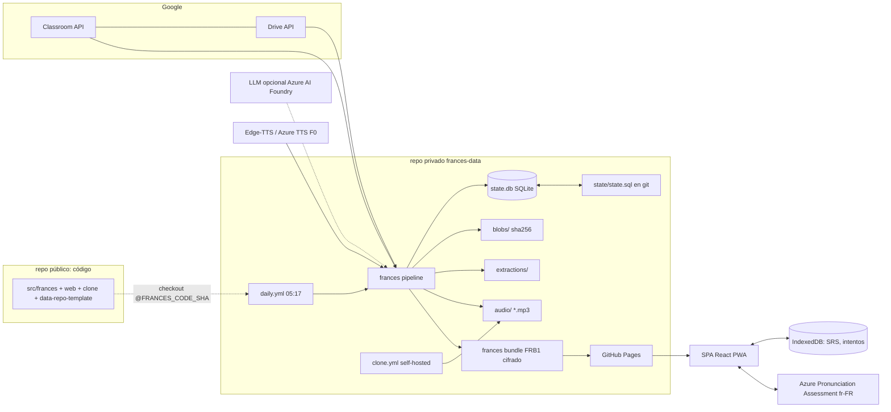

# Spec — App de estudio de francés con Google Classroom

Fecha: 2026-10-14 · Estado: borrador para aprobación · Plan: `docs/superpowers/plans/2026-10-14-00-master-plan.md`

## 1. Intención

Página personal de estudio (un único usuario: el estudiante dueño de la cuenta UNAL) que convierte automáticamente lo que la profesora publica en Google Classroom en práctica: flashcards con repetición espaciada, una ficha de estudio por publicación, audios con voces variadas (adultos, adolescentes, niños) y evaluación objetiva de pronunciación por fonema.

Por qué: el material llega disperso (PDFs, imágenes, anuncios) y no se convierte solo en práctica; la pronunciación necesita retroalimentación medible. Línea base real medida con Azure: 94 global; débiles la nasal /ɑ̃/, la /e/ de «allez» y la /ʁ/.

Éxito significa:

- Cada mañana (05:17 America/Bogota) lo nuevo del Classroom aparece en la app sin intervención humana.
- Cada publicación nueva produce tarjetas y ficha el mismo día; audio adulto el mismo día; audio adolescente/infantil en ≤ 7 días.
- Cualquier tarjeta se puede practicar en voz alta y ver la evolución por fonema.
- Costo mensual 0 USD dentro de free tiers (LLM opcional ≤ 1 USD/mes de crédito Azure for Students).

## 2. Alcance

### Metas (v1)

- G1. Sincronización diaria incremental, solo lectura, de los cursos activos: tareas (`courseWork`), materiales (`courseWorkMaterials`), anuncios, temas; adjuntos de Drive (PDF, imágenes, Docs/Slides/Sheets exportados), enlaces, YouTube y Forms como referencia.
- G2. Extracción de texto: PDF con capa de texto, OCR `fra+spa` para escaneados e imágenes, exportación `text/plain` de Google Docs/Slides.
- G3. Tarjetas (vocabulario, frase, gramática, conjugación, taladro) y una ficha de estudio por publicación; repaso FSRS en el navegador.
- G4. Audio pre-generado por lotes y cacheado por hash: 13 voces Edge-TTS (Azure TTS F0 como respaldo legítimo con las mismas voces); voces adolescentes/infantiles por clonación (Chatterbox Multilingual o XTTS v2, elegido por benchmark). Nunca en runtime.
- G5. Evaluación de pronunciación con Azure Pronunciation Assessment (fr-FR) desde el navegador: puntajes de frase, palabra y fonema; historial; taladro automático de fonemas débiles.
- G6. Todo en GitHub: código, CI, pipeline programado, almacenamiento de datos y hosting.

### No-metas (v1)

Multiusuario o compartir con compañeros · escribir en Classroom o entregar tareas · calificaciones/entregas (`studentSubmissions`) · sincronizar el progreso SRS entre dispositivos (sí exportar/importar JSON) · descargar videos · app nativa · servidor propio en runtime.

### Anti-metas (fracaso aunque “funcione”)

- Material de la profesora o datos de compañeros legibles públicamente (repo público, logs públicos de Actions, sitio sin cifrar).
- Clave de Azure, refresh token de Google o passphrase en git o en un archivo publicado sin cifrar.
- Clonar la voz de un menor real sin consentimiento documentado de su tutor.
- Un fallo de sync que borre o corrompa datos o el progreso de estudio.
- Audio sintetizado en runtime.

## 3. Restricciones dadas

- API oficial de Classroom con la cuenta de estudiante; watermark incremental en SQLite.
- Azure Speech: recurso `frances-speech`, tier F0, región `eastus`. Script de prueba existente (`~/Escritorio/Azure/azure_pronunciation_test.py`, lee `AZURE_SPEECH_KEY`/`AZURE_SPEECH_REGION`, soporta `DUMP_JSON`).
- Edge-TTS (13 voces francesas); XTTS v2 o Chatterbox para adolescentes/niños.
- Hosting en GitHub. Repo de código existente: `JuanCardenas27/Muy-bien-trabajo-MAIS-TOUT-VA-MAL` (público; el usuario `NigrumH0do` tiene permiso WRITE, no admin).
- Máquina local: 12 núcleos, 30 GB RAM, sin GPU NVIDIA; tiene `ffmpeg`, `espeak-ng`, `tesseract`, `sqlite3`, `uv`, Node 22, `gh` autenticado.

## 4. Decisiones del “cómo”

Todas son decisiones del diseñador (no acordadas aún con el usuario) salvo las marcadas [usuario].

- D1. Dos repositorios. Público (el existente): solo código, fixtures sintéticos y un demo. Privado nuevo `frances-data`: datos, secretos, workflows programados y Pages. Motivo: el repo actual es público y los logs de Actions de un repo público son públicos.
- D2. El sitio se publica con GitHub Pages desde `frances-data` (Pages en repo privado requiere GitHub Pro, gratis con GitHub Student Developer Pack). El sitio de Pages es público, así que todo el contenido va cifrado (formato FRB1: AES-256-GCM, clave PBKDF2-SHA256 600 000 iteraciones desde una passphrase). Plan B sin Pro: repo público `frances-site` que solo recibe shell + bundle cifrado vía deploy key.
- D3. Pipeline en Python 3.12 + uv, CLI `frances`. SQLite es el store de trabajo [usuario]; se persiste en git como volcado SQL determinista `state/state.sql` (git guarda deltas de texto pequeños; un `.db` binario diario inflaría el historial). Archivos content-addressed por sha256.
- D4. Cada día se consulta la `version` en Drive de cada adjunto conocido: la profesora puede editar un PDF sin tocar la publicación, y el watermark de Classroom no lo vería.
- D5. Tarjetas: generador LLM opcional vía endpoint compatible con OpenAI (objetivo: modelo pequeño en Azure AI Foundry con crédito Students, disponibilidad por verificar) con respaldo determinista siempre disponible (spaCy `fr_core_news_sm` + Azure Translator F0 fr→es, 2 M caracteres/mes gratis, con tope medido de 1,8 M). GitHub Models se retiró el 2026-07-30, así que no se usa. Se descartó la traducción offline (Argos/OPUS-MT): o arrastra torch al job diario o no tiene par fr→es directo.
- D6. Política de voces: cada tarjeta recibe audio en 2 voces fijas (`fr-FR-DeniseNeural`, `fr-FR-HenriNeural`) + 1 rotativa determinista del resto de voces habilitadas; las tarjetas de taladro reciben todas las voces habilitadas (todas las edades). Configurable.
- D7. La clonación corre en un proceso aislado (proyecto uv aparte, Python 3.11 por torch) sobre un runner self-hosted en el PC del usuario (CPU), por lotes con tope. Cada clip pasa QA automática con faster-whisper: se acepta si CER ≤ 0.15.
- D8. Voces infantiles: `fr-FR-EloiseNeural` (incluida en Edge-TTS) aparece catalogada como voz infantil en catálogos de terceros; se verifica de oído (SPK-02) y, si sirve, es la voz infantil gratuita base. Para clonar se usan solo referencias sintéticas (derivadas de TTS) o grabaciones con consentimiento escrito (del tutor si es menor), registradas en `voices.yaml`. Nunca datasets con menores identificables.
- D9. Frontend: Vite + React + TypeScript estricto, PWA offline, FSRS (`ts-fsrs`), IndexedDB (`idb`), visor PDF (`pdfjs-dist`). UI en español.
- D10. Azure Speech desde el navegador con `SpeechConfig.fromSubscription`; la clave viaja dentro del índice cifrado y solo es accesible con la passphrase. F0 no factura: el peor caso de filtración es agotar la cuota del mes. v2 opcional: broker de tokens en Azure Functions.
- D11. Horario 05:17 America/Bogota (`17 10 * * *` UTC). Reconciliación completa semanal (domingo 06:00 Bogotá) para detectar borrados. Clonación semanal (domingo) y manual.
- D12. Cadena de suministro: los workflows viven en `frances-data` y hacen checkout del código público en el SHA de la variable `FRANCES_CODE_SHA` (nunca una rama), así los secretos solo los ve código revisado. Se descartó `workflow_call` entre dueños distintos porque obliga a pasar los secretos uno por uno. El runner self-hosted se registra solo en el repo privado. `main` del repo público lleva branch protection y CI obligatorio.

## 5. Arquitectura

Etapas del pipeline diario, en orden: `restore → sync → fetch → extract → cards → phonemize → audio(edge|azure) → dump → commit → bundle → deploy`. Cada etapa es idempotente, se salta lo ya hecho (claves = hash de entradas + versión del productor) y deja el estado consistente aunque falle a mitad.

## 6. Comportamiento

### 6.1 Sync incremental (watermark)

Por cada curso incluido y cada stream (`coursework`, `material`, `announcement`): listar con `orderBy="updateTime desc"`, `pageSize=100`; cortar al ver `updateTime < watermark − 10 min` (el solape cubre relojes desfasados; el upsert lo vuelve inocuo); upsert de publicación y adjuntos; al terminar el stream, en la misma transacción, `watermark = max(watermark, max updateTime visto)`. Si el stream falla, su watermark no se mueve. Los temas se listan completos (son pocos).

### 6.2 Cambios y borrados

- Publicación editada → `update_time` nuevo → se re-sincroniza; adjuntos nuevos se descargan; adjuntos quitados reciben `removed_at`.
- Archivo de Drive editado sin tocar la publicación → detectado por `version` (D4) → re-descarga → nuevo blob → nueva extracción → tarjetas regeneradas.
- Publicación borrada → la API ya no la devuelve → la reconciliación semanal (listado completo) marca `deleted_at`.
- Tarjetas cuyo único origen desaparece → `stale=true`: salen de la cola de repaso, conservan su historial; nunca se borran.

### 6.3 Descarga y extracción

- Binarios (`files.get alt=media`) hasta 50 MB; más grandes → `skipped_too_large` con enlace.
- Nativos de Google: exportar PDF (para ver) y `text/plain` (para extraer); si el PDF excede el límite de exportación (10 MB), solo texto.
- `capabilities.canDownload=false` o 403 → `forbidden`; 404 → `not_found`; la publicación y su texto se sincronizan igual.
- PDF: texto con pypdfium2; si una página tiene < 40 caracteres útiles, OCR de esa página a 200 dpi. Imágenes: OCR. Idioma por bloque (`fr`/`es`/`mixed`).

### 6.4 Tarjetas y fichas

- Unidad de generación: una publicación (su texto + extracciones de sus adjuntos). Se regenera solo si cambia el hash de esa entrada o la versión del generador.
- `card_id = "c_" + sha256(norm_key(front_fr) + "\x1f" + kind)[:16]`: la misma palabra desde dos materiales es una sola tarjeta con dos orígenes; regenerar no pierde el progreso.
- Normalización: NFC, apóstrofo tipográfico ’ → ', comillas « » y espacios finos/no separables fuera de la clave, minúsculas; el texto mostrado conserva la tipografía original.
- Ficha de estudio por publicación: resumen en español, vocabulario (ids de tarjetas), puntos de gramática con ejemplos, frases clave.
- Taladro: mazo curado inicial para /ɑ̃/ /ɔ̃/ /ɛ̃/, /e/ vs /ɛ/, /ʁ/ + mazos automáticos por fonema a partir del IPA de cada tarjeta (espeak-ng).

### 6.5 Audio

- Clave de caché: `sha256(json canónico {t: tts_norm(texto), v: voice_id, f: familia, fv: versión de familia})[:32]`. Edge y Azure comparten la familia `ms-neural` (son las mismas voces neuronales), así que el respaldo no duplica clips. Archivo `audio/<clave>.mp3`, MP3 mono 24 kHz 48 kbps, loudness −16 LUFS para que todas las voces suenen parejas.
- Edge-TTS a diario (concurrencia 2, reintentos con backoff). Si Edge falla de forma no recuperable, cae a Azure TTS F0 con tope de 450 000 caracteres/mes medidos.
- Clonación semanal en el runner local, máximo 400 clips por ejecución, QA CER ≤ 0.15 (hasta 3 intentos; luego `failed_qa`).
- La app muestra «audio pendiente» cuando falta un clip; nunca sintetiza.

### 6.6 Bundle cifrado (FRB1)

`bundle.json` público (solo parámetros KDF, sal, comprobación de clave, URL del índice) + archivos `d/<sha256(cifrado)[:32]>.bin` inmutables. El índice (cursos, publicaciones, adjuntos, tarjetas, fichas, voces, mapa de audio, mapa de archivos, mazos de taladro, credenciales de Azure Speech) va en JSON comprimido con gzip y cifrado. Tamaño total ≤ 900 MB (Pages admite 1 GB).

### 6.7 App

Pantallas: Desbloquear · Hoy (repasos pendientes, tareas próximas, publicaciones nuevas, taladro sugerido) · Classroom (publicaciones por tema) · Detalle de publicación (texto, visor de PDF/imagen, ficha) · Repaso (FSRS, teclas 1–4) · Tarjetas (buscador) · Práctica (escuchar modelo → grabar → puntajes) · Progreso (mapa de fonemas, historial, uso de cuota) · Ajustes (voces preferidas, exportar/importar progreso, bloquear). La clave derivada se guarda como `CryptoKey` no extraíble en IndexedDB: la passphrase se escribe una vez por dispositivo. Offline-first (service worker). Accesible: teclado, ARIA, puntajes con texto además de color, contraste AA.

### 6.8 Pronunciación

Escuchar el modelo → grabar con el micrófono → `PronunciationAssessmentConfig(referenceText, HundredMark, Phoneme, enableMiscue=true)`, locale `fr-FR` → puntaje global, exactitud, fluidez, completitud, palabras coloreadas y fonemas por palabra. Estadística por fonema con media móvil exponencial (α = 0.3, mínimo 3 observaciones); semilla de debilidad: `ɑ̃`, `e`, `ʁ`. Contador de segundos evaluados por mes con aviso a 4 h (F0 = 5 h). El audio del usuario solo va a Azure; los intentos se guardan localmente.

### 6.9 Operación y fallos

- Refresh token inválido → la etapa sync aborta antes de escribir (código 3) y abre o actualiza un único issue «Re-autoriza Google» en `frances-data`; el sitio del día anterior sigue arriba.
- Fallos parciales (un adjunto, un clip) no detienen el pipeline: se registran (código 2) y se reintentan al día siguiente.
- Cualquier otro fallo → issue `pipeline-failure` con enlace al run (GitHub avisa por correo).
- Concurrencia: grupo `frances-data`, sin cancelar en curso.

## 7. Presupuestos

| Recurso | Límite | Uso previsto / control |
|---|---|---|
| Azure STT/pron. F0 | 5 h audio/mes | Frases de 2–6 s; aviso en la app a 4 h |
| Azure TTS F0 | 0,5 M caracteres/mes | Solo respaldo; tope 450 000 medido en `usage` |
| Azure Translator F0 | 2 M caracteres/mes | Tope 1 800 000 medido; si se agota, la traducción queda pendiente y se reintenta |
| GitHub Actions privado | 2 000 min/mes (3 000 con Pro) | Diario ≈ 10–15 min; clonación en self-hosted (no consume) |
| GitHub Pages | sitio 1 GB, ~100 GB/mes de tráfico | Bundle ≤ 900 MB con fallo duro en CI |
| Archivos de git | 100 MB por archivo | Adjuntos > 50 MB no se descargan |
| LLM (opcional) | crédito Students | ≤ 30 publicaciones/día por LLM, resto con regla |

## 8. Riesgos

| Riesgo | Mitigación |
|---|---|
| App OAuth en modo «Testing» → refresh token caduca a los 7 días | Publicar la pantalla de consentimiento en «In production» (app no verificada, uso propio) — SPK-05 |
| Admin de Google Workspace UNAL bloquea apps de terceros | SPK-05 lo detecta el día 1; plan B: ejecutar `frances sync` local con cron del PC |
| Edge-TTS es un endpoint no oficial y puede romperse | Versión fijada; respaldo Azure TTS F0 con las mismas voces |
| XTTS v2 alucina en frases cortas | QA con faster-whisper; Chatterbox como alternativa; elección por SPK-03 |
| Licencia XTTS v2 (CPML, no comercial) | Uso personal únicamente; documentado |
| Crecimiento del repo de datos | Content-addressing, volcado SQL de texto, `frances doctor --sizes` |
| Passphrase débil → fuerza bruta offline del bundle | Mínimo 24 caracteres validado en `frances bundle`; recomendación 5+ palabras aleatorias |

## 9. Decisiones que quedan al constructor

Estructura interna de cada módulo más allá de las interfaces del plan maestro; estilos visuales (siguiendo los tokens de WEB-01); heurísticas exactas del generador por reglas; prompts del LLM (validados por esquema); textos de la UI.

## 10. Lo que solo el usuario puede decidir o hacer

1. Aprobar D1/D2 (repo privado de datos + Pages cifrado) o pedir al dueño `JuanCardenas27` que vuelva privado el repo actual.
2. Activar GitHub Student Developer Pack (GitHub Pro) en la cuenta dueña de `frances-data`.
3. Elegir la passphrase del sitio (≥ 24 caracteres).
4. Decidir la fuente de las referencias de voz adolescente/infantil (sintética o grabación con consentimiento).
5. Crear el proyecto de Google Cloud y el cliente OAuth, publicar la app en producción y autorizar con la cuenta UNAL (guiado en LIVE-01).
